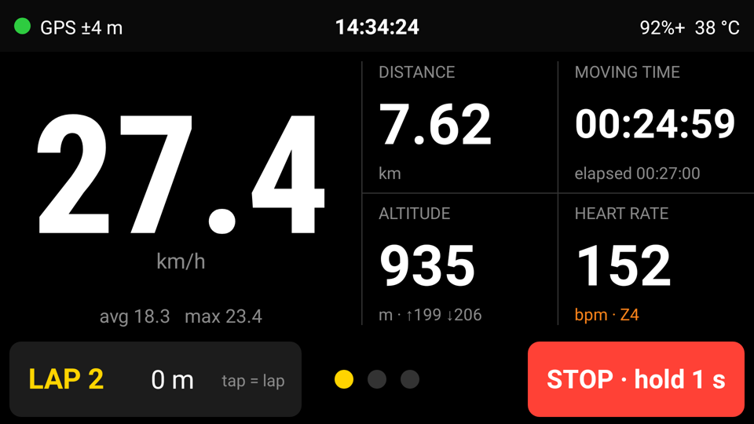
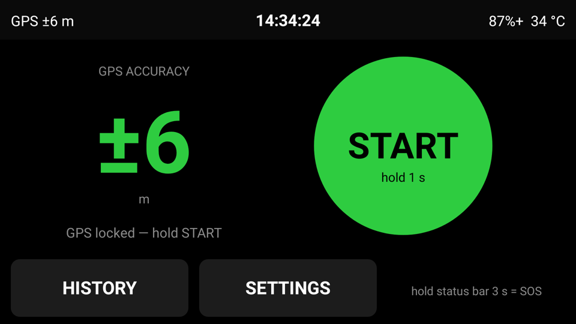
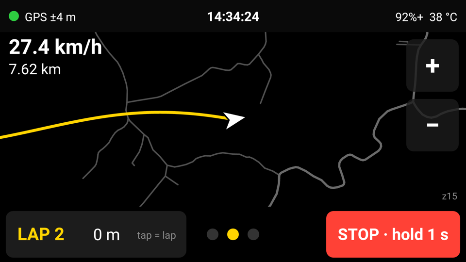
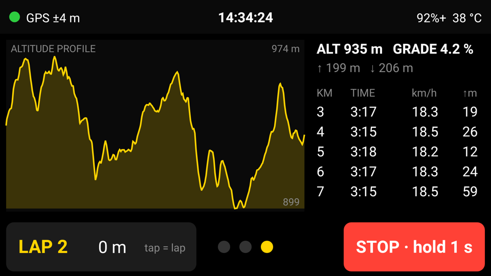
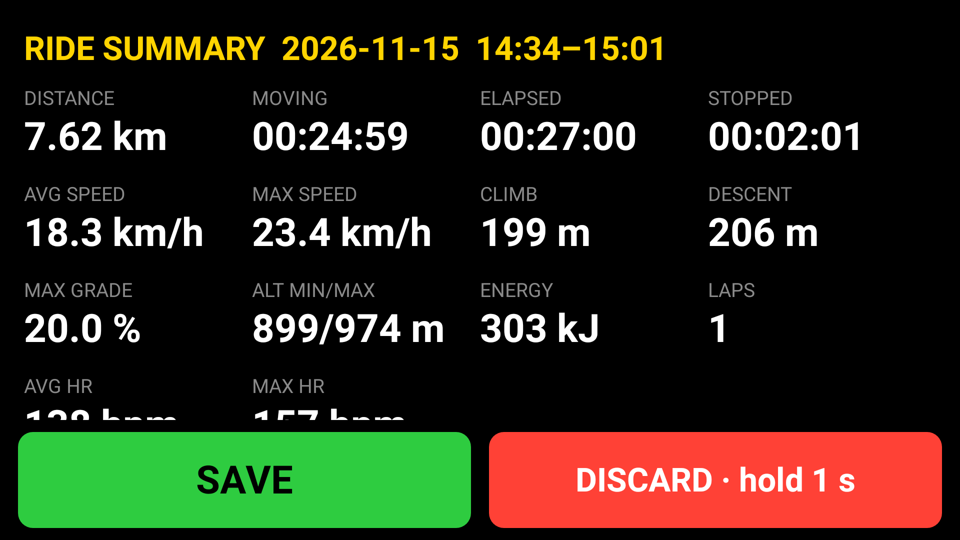

# oldmobileasadash

Transforma celular antigo em dashboard para bicicleta ou carro.

**BikeTracker** — offline bike computer for an Asus Zenfone 3 (ZE520KL, Android 8.0) mounted
landscape on the handlebar, riding inside a 20 km circle around Campo Largo, PR.
Built from `Bike Tracker App — Baseline Spec`.

## Install

1. Download [`release/BikeTracker-1.0.0.apk`](release/BikeTracker-1.0.0.apk) to the phone
   (USB, cloud folder, or `adb install release/BikeTracker-1.0.0.apk`).
2. Allow "Install unknown apps" for the file manager you open it with.
3. First start asks for location, SMS, phone and the battery optimization exemption — say yes to all.
4. Settings: rider mass, bike mass, max HR, the 2 emergency contacts, SMS language, HR sensor.
   Run the crash test once (no SMS, no call).



| | |
|---|---|
|  |  |
|  |  |

## What is inside

- Native Kotlin, minSdk 26, no AndroidX, no network. One foreground service owns GPS (1 Hz), BLE HR (0x180D/0x2A37,
  reconnect every 10 s), accelerometer (50 Hz, crash only), battery temperature (30 s) and recording.
- GPS filter: accuracy ≤ 20 m, jumps > 25 m/s dropped, Kalman speed and position, distance only on ≥ 2 m moves,
  auto-pause < 3 km/h for 5 s, resume > 5 km/h.
- Altitude from SRTM 1" tile S26W050 (cropped to the area, bilinear), GPS fallback outside it; climb in 3 m steps,
  grade over 50 m.
- Offline vector map extracted from the Mapsforge "sul" map (roads, water, places), dark theme, north-up,
  yellow track, white heading arrow, 10 km home ring, +/− zoom (no pinch).
- Crash: impact ≥ 3.5 g while moving ≥ 10 km/h → stopped < 3 km/h within 15 s → still (< 0.3 g variation) 30 s →
  30 s alarm with CANCEL on the lower half → SMS with map link to both contacts → 45 s speaker call to each.
  Manual SOS: hold the status bar 3 s.
- Heat: ≥ 45 °C dims the screen and warns, ≥ 50 °C red alarm banner. Low battery warning when not charging.
- SQLite (rides, points, laps, events), points written in batches of 15. Summary, history with week/month totals,
  ride detail with FIT and GPX export through the share sheet (also saved in
  `Android/data/com.oldmobile.biketracker/files/exports`). FIT goes to Apple Health via Flow Sync or HealthFit.

## Build

```bash
./gradlew assembleRelease     # or: gradle assembleRelease (Gradle 8.14, JDK 17+, Android SDK 34)
```

Tests: `gradle testDebugUnitTest` (engine, crash logic, assets, FIT round-trip, and Robolectric
screenshots into `app/build/screens`).

Map and terrain data are regenerated with `tools/mapextract` (Mapsforge `sul.map`) and
`tools/terrain_crop.py` (SRTM `S26W050.hgt`). The release keystore in `keystore/` is committed on purpose
so every future build can update the installed app; it is not a secret.

Map data © OpenStreetMap contributors (ODbL), via mapsforge.org. Terrain: NASA SRTM.
